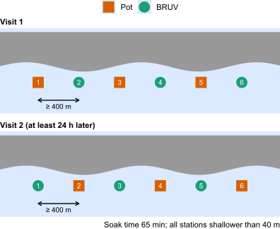

## Objectives

- **Objective 1:** annotation of stereo-BRUV footage from Dusky Sound: 102 deployments from 2025, and 94 deployments from 2024 updated to the current protocol
- **Objective 2:** field experiment comparing blue cod pots with stereo-BRUVs in Dusky Sound
- **Objective 3:** standardisation framework for Fiordland stereo-BRUV data, and the power of stereo-BRUV indices to detect change in fish populations

::: notes
- Objective 1 covers the 2024 and 2025 footage only. The 2021 footage is priced separately as additional scope.
- The 2024 annotations under SEA2023-15 recorded MaxN for the focal species only. The update records MaxN for every species, plus covariates such as water clarity.
- Two indices per deployment: MaxN, and MeanCount (the mean count across seven frames at 0, 10, 20, 30, 40, 50 and 60 min).
- Objective 3 is analogous to CPUE standardisation, using count-based GLMMs fitted with brms and Stan.
:::

## Milestones

| Milestone | Deliverable | Due |
|----|-------------|-----|
| MS3 | Methods to FMG, BRAG and other working groups | 30 Nov 2026 |
| MS5 | Annotation summary report and annotated dataset | 30 Jun 2027 |
| MS6 | Draft AEBR; final results to BRAG | 15 Dec 2027 |
| MS7 | Final AEBR | 31 Mar 2028 |

::: notes
- MS3 is the next deliverable; the BRAG meeting on 24 November falls within it.
- Not shown: MS4, the health and safety plan, due 31 May 2027 and at least one month before mobilisation; MS8, data submission, due 31 March 2028.
:::

## Experimental design

::: {style="background: rgba(153, 217, 234, 0.25); border-left: 5px solid #027DBF; border-radius: 4px; padding: 0.4em 0.8em; margin-bottom: 0.6em;"}
**Aim:** compare catch rates and selectivity of pots vs BRUVs at the same stations — can the new BRUV monitoring be linked to the historical potting series?
:::

::::: {.columns}

::: {.column width="45%"}
```{r}
#| echo: false


```
:::

:::: {.column width="55%"}
::: {style="font-size: 0.8em; line-height: 1.3; margin-top: 2.5em;"}
- Outer Dusky Sound: three strata, 36 stations, all shallower than 40 m
- Each station sampled by both gears in counterbalanced order (AB/BA crossover)
- 65 min soak from touchdown; FNZ potting manual where possible (Beentjes 2019)
- Stereo cameras on the pots if feasible (not essential to Objective 2)
:::
::::

:::::


::: notes
- The link holds only if the ratio between pot and BRUV indices is stable across depth, water clarity and blue cod density; the experiment tests that.
- Each station is sampled by both gears, so each station is its own control. Blue cod MaxN across the annotated 2025 deployments ranges from 0 to 31; a between-station comparison would have to estimate the gear effect against that variation.
- Carry-over from the first visit (fish caught and released, the bait plume) is limited by leaving at least one day between visits, and the counterbalanced order keeps any carry-over from being confounded with gear.
- Revisiting in the same order samples each station at about the same time of day under both gears.
- In the 2025 data, blue cod were most abundant shallower than 40 m and scarce below about 70 m.
- Schematic: one set of six stations. Orange squares are pots and green circles are BRUVs.
- The gear at each station is swapped on the return visit, at least 24 h later.
- Each set is revisited in the same order.
- Two sets per day over six deployment days; a third set per day if time and conditions allow.
:::

## Field timing

- Proposed window: late August to early September 2027
- Vessel: DOC *Southern Winds*, available July to September 2027

::: notes
- Seven-day vessel period: six deployment days, plus one for transit, maintenance and contingencies.
- All previous Fiordland BRUV campaigns used *Southern Winds*, which is equipped for both BRUVing and potting.
:::

## Pots: standardisation and camera mounting

- Use historical potting protocols from the FNZ potting manual as far as possible
- Counts and lengths only (no otoliths or sex determination)
- For discussion with Pete: pot design, bait, etc. 
- Camera mounting options:
  1. inside the pot
  2. on the outside of the pot, facing the entrance
  3. on a separate frame facing the pot

::: notes
- Lifting pots on time is the priority, because the BRUV annotation period is fixed regardless of soak time.
- Pot cameras would record the size structure and behaviour of fish around the pots, including entry and exit. Annotation of pot footage is offered as additional scope.
- Questions: can pots matching the historical surveys be borrowed, and what bait and quantity did those surveys use?
:::

## Taumoana (Five Finger Peninsula) Marine Reserve

- Should the experiment include pot stations inside the reserve?
- Can potting inside the reserve be permitted?

::: notes
- The stratum on the exposed outer coast may overlap the reserve.
- Objective 3 reports results by protection status, as an observational contrast confounded with depth and habitat.
- Questions for Rich: does the experiment need stations inside the reserve, and would DOC permit potting there?
:::


## Meetings

  - FMG monitoring subcommittee: **11 November 2026**
       - Confirmed?
       - FMG-proper meeting?
  - BRAG meeting: **24 November 2026** (MS3)
  
PDF of the slides circulated before each meeting

::: notes
- The subcommittee meeting includes Pete.
- Questions: who should receive the PDF, and how far in advance?
:::

## Planned content

- Approach to the whole project:
  - desktop project: standardisation framework for Fiordland stereo-BRUV data, with simulations of the power of stereo-BRUV indices to detect change
  - pot–BRUV field experiment
- Largely the same content for both presentations

::: notes
- The framework will use new covariates recorded from the footage (depth, habitat, current, water clarity) to standardise the BRUV index between years.
- Simulations from the fitted models give the number of stations needed for benchmark precision, and the change detectable at a given number of stations, strata and stations per stratum.
- Benchmark: the Dusky Sound potting survey achieved a CV of 11.9% from 28 fixed sites and 8.6% from 34 random sites (Beentjes & Page 2016).
:::

## Permits and approvals

- MPI special permit for potting — obtained for 2025 but not used
- DOC permit for any potting inside Taumoana (Five Finger Peninsula) Marine Reserve (if that's the plan)
- Animal ethics approval from an ethics committee (Earth Sciences or Auckland Uni), because potting involves handling live fish
- Health and safety plan (MS4, due 31 May 2027)

::: notes
- The ethics committee options were discussed with Jean at the last meeting.
- The DOC permit applies only if potting inside the reserve goes ahead.
:::
